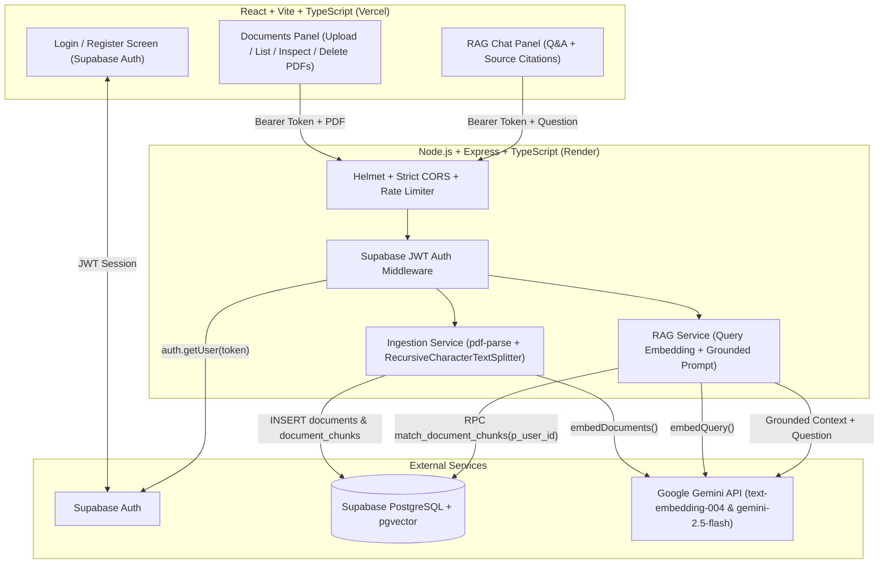

[Türkçe Dokümantasyon](README.tr.md)

# Mini RAG — Document Assistant

An end-to-end **Full-Stack RAG (Retrieval-Augmented Generation)** application that enables authenticated users to upload PDF documents, index them into a vector database, and ask natural-language questions answered strictly from their uploaded documents with transparent source citations.

---

## 1. Project Overview & Key Features

- **Authentication (Supabase Auth):** Email and password registration, login, and JWT session management.
- **PDF Document Management & Synchronous Ingestion:**
  - Drag-and-drop or file picker PDF uploads (`POST /api/documents`).
  - Client- and server-side file type (`.pdf` extension, MIME type, and `%PDF-` magic header signature) and size validation (default max `10 MB`).
  - PDF text extraction (`pdf-parse`), overlapping text chunking (`@langchain/textsplitters` — `RecursiveCharacterTextSplitter`), and vector embedding generation (`@langchain/google-genai` — `text-embedding-004`, 768 dimensions).
  - Document processing status tracking (`processing`, `completed`, `failed`), chunk count inspection (`GET /api/documents/:id`), and two-step confirmed document deletion (`DELETE /api/documents/:id`).
- **Grounded RAG Chat with Citations (`POST /api/chat`):**
  - Converts user questions into 768-dimensional query embeddings and performs cosine similarity search via Supabase `pgvector` (`match_document_chunks` RPC).
  - Supports querying across all completed documents or filtering by a single selected document.
  - Synthesizes grounded answers (`gemini-2.5-flash`) strictly from retrieved excerpts and displays collapsible source citations (filename, `Chunk #N`, similarity percentage, and text excerpt) beneath each response.
  - Prevents LLM hallucinations by returning a deterministic fallback message without invoking the LLM when no relevant chunks exceed the similarity threshold.

---

## 2. Technology Stack

| Layer | Technology | Purpose |
| --- | --- | --- |
| **Frontend** | React 19 + TypeScript + Vite | SPA user interface, Auth flow, Document management, and RAG Chat UI |
| **Backend** | Node.js + Express 5 + TypeScript | REST API, JWT authentication, file verification, and RAG orchestration |
| **Authentication** | Supabase Auth | JWT-based user sign-up, sign-in, and access token verification |
| **Database** | Supabase PostgreSQL + `pgvector` | Document metadata, text chunks, and 768-dim vector similarity search |
| **AI / RAG** | LangChain.js (`@langchain/google-genai`, `@langchain/textsplitters`) | Text chunking, `text-embedding-004` embeddings, and `gemini-2.5-flash` chat completion |
| **Security & Validation** | `helmet`, `cors`, `express-rate-limit`, `multer`, `zod` | HTTP security headers, strict CORS, rate limiting, and schema validation |
| **Testing & Quality** | Vitest + Supertest + ESLint + TypeScript | Unit and API integration tests, static type checking, and linting |
| **CI & Deployment** | GitHub Actions + Docker + Vercel + Render | Automated CI checks, Docker build verification, Vercel (Frontend), and Render (Backend) |

---

## 3. System Architecture & Data Flow



### 3.1. Ingestion Pipeline (Document Upload Flow)

```text
React UI
  │  POST /api/documents (Bearer JWT + multipart/form-data PDF)
  ▼
Express API (Auth Middleware + Rate Limiter + Multer + %PDF- Magic Header Check)
  │
  ├─► 1. Insert initial record in `documents` table with status='processing'
  ├─► 2. Extract raw text from PDF buffer using `pdf-parse`
  ├─► 3. Split text into overlapping chunks (1000 chars, 200 overlap) via `RecursiveCharacterTextSplitter`
  ├─► 4. Generate 768-dimensional vector embeddings for each chunk via Gemini `text-embedding-004`
  ├─► 5. Bulk-insert chunk text, embeddings, and metadata into `document_chunks`
  └─► 6. Update `documents.status` to 'completed' (or 'failed' + `error_message` on error)
```

### 3.2. RAG Query Pipeline (Question-Answering Flow)

```text
React UI
  │  POST /api/chat (Bearer JWT + { question, documentId? })
  ▼
Express API (Auth Middleware + Rate Limiter + Zod Schema Validation)
  │
  ├─► 1. Generate a 768-dimensional query embedding via Gemini `text-embedding-004`
  ├─► 2. Execute `match_document_chunks` pgvector RPC scoped strictly to `req.user.id`
  │      and `documents.status = 'completed'` using cosine similarity
  ├─► 3. If no chunks meet the similarity threshold (0.3), skip the LLM call and return a safe fallback message
  ├─► 4. Format retrieved chunks with source tags ([Source N | Document | Chunk #]) into a grounded prompt
  ├─► 5. Generate an answer with Gemini 2.5 Flash constrained strictly to the provided excerpts
  └─► 6. Return `{ answer, sources }` to the frontend for rendering
```

---

## 4. Security Layers (Defense-in-Depth)

1. **Server-Side JWT Verification (`createAuthMiddleware`):** The backend never trusts client-supplied user IDs. Every protected request validates the `Authorization: Bearer <token>` header against Supabase `auth.getUser(token)`.
2. **IDOR (Insecure Direct Object Reference) Prevention:** Every `SELECT`, `UPDATE`, `DELETE`, and `pgvector` RPC (`match_document_chunks`) call explicitly filters by `user_id = req.user.id`. Attempting to read, delete, or query another user's document returns `404 Not Found`.
3. **Supabase Row Level Security (RLS):** Database-level RLS policies (`auth.uid() = user_id`) are enabled on both `documents` and `document_chunks` tables as defense-in-depth.
4. **Multi-Layered PDF Verification:** Beyond checking the `.pdf` extension and `application/pdf` MIME type, the server inspects the first 5 bytes of the uploaded buffer for the `%PDF-` magic header signature and enforces a strict file size limit (`MAX_UPLOAD_SIZE_MB`).
5. **Grounded Prompting & Hallucination Guardrails:** When similarity search returns zero matching chunks above threshold, the LLM is not invoked. When context is present, system instructions require the model to answer exclusively from the provided excerpts.
6. **Rate Limiting (`express-rate-limit`):** `POST /api/chat` and `POST /api/documents` are protected by a per-user/IP rate limiter (default max 20 requests per minute) to prevent quota exhaustion and abuse (`429 Too Many Requests`).
7. **Strict CORS & Security Headers (`helmet`):** The API only permits cross-origin browser requests from origins listed in `ALLOWED_ORIGIN` and rejects unauthorized origins with `403 Not allowed by CORS`.
8. **Secret Isolation:** `SUPABASE_SERVICE_ROLE_KEY` and `GEMINI_API_KEY` reside exclusively in backend environment variables and are never exposed to the frontend bundle.

---

## 5. API Endpoints

All `/api/*` endpoints require an `Authorization: Bearer <supabase_access_token>` header.

| Method | Endpoint | Description |
| --- | --- | --- |
| `GET` | `/health` | Health check endpoint (`{ "status": "ok" }`) |
| `POST` | `/api/documents` | Upload a PDF (`multipart/form-data`, field name: `file`) and run synchronous ingestion |
| `GET` | `/api/documents` | List all documents belonging to the authenticated user |
| `GET` | `/api/documents/:id` | Retrieve document details including total `chunkCount` |
| `DELETE` | `/api/documents/:id` | Delete a user-owned document and cascade-delete its `document_chunks` |
| `POST` | `/api/chat` | Ask a question across uploaded documents (`{ "question": "...", "documentId"?: "..." }`) |

---

## 6. Local Setup Instructions

### Prerequisites

- **Node.js** 20+ (or 22/24 LTS) and **npm**
- A **Supabase** project (free tier works out of the box)
- A **Google AI Studio (Gemini)** API key (`GEMINI_API_KEY`)

### Step 1: Initialize the Supabase Database Schema

1. Open your Supabase Dashboard → **SQL Editor**.
2. Paste and run the contents of [backend/supabase/migrations/001_init_rag_schema.sql](backend/supabase/migrations/001_init_rag_schema.sql) (enables `pgvector`, creates `documents` and `document_chunks` tables, enables RLS policies, and defines the `match_document_chunks` RPC function).

### Step 2: Configure Environment Variables

**Backend (`backend/.env`):**

Copy `backend/.env.example` to `backend/.env` and fill in your credentials:

```env
PORT=4000
ALLOWED_ORIGIN=http://localhost:5173
SUPABASE_URL=https://<project-id>.supabase.co
SUPABASE_ANON_KEY=<supabase-anon-key>
SUPABASE_SERVICE_ROLE_KEY=<supabase-service-role-key>
GEMINI_API_KEY=<google-gemini-api-key>
GEMINI_EMBEDDING_MODEL=text-embedding-004
GEMINI_CHAT_MODEL=gemini-2.5-flash
MAX_UPLOAD_SIZE_MB=10
```

**Frontend (`frontend/.env`):**

Copy `frontend/.env.example` to `frontend/.env` and fill in your configuration:

```env
VITE_API_BASE_URL=http://localhost:4000
VITE_SUPABASE_URL=https://<project-id>.supabase.co
VITE_SUPABASE_ANON_KEY=<supabase-anon-key>
```

### Step 3: Install Dependencies & Run

#### Option A — Run Directly with Node.js

```bash
# 1. Install backend dependencies and start the dev server (http://localhost:4000)
cd backend
npm install
npm run dev

# 2. In a separate terminal, install frontend dependencies and start Vite (http://localhost:5173)
cd frontend
npm install
npm run dev
```

#### Option B — Run with Docker Compose (Optional)

Once `backend/.env` and `frontend/.env` are configured, build and start both containers with a single command:

```bash
docker compose --env-file ./frontend/.env up --build
```

- **Frontend (Nginx):** `http://localhost:5173`
- **Backend (Express API):** `http://localhost:4000`

---

## 7. Testing & Quality Checks

```bash
# Backend: TypeScript typecheck, ESLint, Vitest test suite, and production build
npm --prefix backend run typecheck
npm --prefix backend run lint
npm --prefix backend test
npm --prefix backend run build

# Frontend: TypeScript typecheck, ESLint, and Vite production build
npm --prefix frontend run typecheck
npm --prefix frontend run lint
npm --prefix frontend run build
```

---

## 8. Deployment Guide

### 8.1. Backend Deployment (Render)

1. Create a new **Web Service** on Render connected to your GitHub repository.
2. **Root Directory:** `backend`
3. **Build Command:** `npm ci && npm run build`
4. **Start Command:** `npm start`
5. **Environment Variables:**
   - `NODE_ENV=production`
   - `ALLOWED_ORIGIN=https://<your-vercel-frontend-domain>.vercel.app`
   - `SUPABASE_URL`, `SUPABASE_ANON_KEY`, `SUPABASE_SERVICE_ROLE_KEY`
   - `GEMINI_API_KEY`, `GEMINI_EMBEDDING_MODEL=text-embedding-004`, `GEMINI_CHAT_MODEL=gemini-2.5-flash`
   - `MAX_UPLOAD_SIZE_MB=10`

### 8.2. Frontend Deployment (Vercel)

1. Import your GitHub repository into a new Vercel project.
2. **Root Directory:** `frontend`
3. **Framework Preset:** `Vite`
4. **Build Command:** `npm run build` / **Output Directory:** `dist`
5. **Environment Variables:**
   - `VITE_API_BASE_URL=https://<your-render-backend-domain>.onrender.com`
   - `VITE_SUPABASE_URL=https://<project-id>.supabase.co`
   - `VITE_SUPABASE_ANON_KEY=<supabase-anon-key>`
