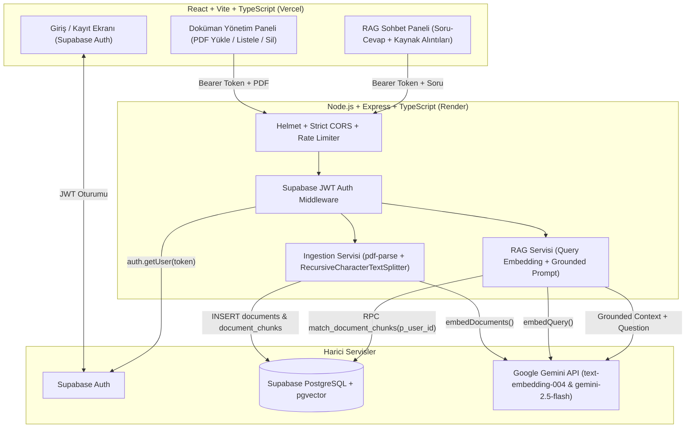

[English Documentation](README.md) | **[🚀 Canlı Demo](https://mini-rag-assistant-ddnb.vercel.app/)**

# Mini RAG — Document Assistant

[](https://mini-rag-assistant-ddnb.vercel.app/)
[](https://www.typescriptlang.org/)
[](https://react.dev/)
[](https://expressjs.com/)
[](https://supabase.com/)

> **Canlı Uygulama (Live Demo):** [https://mini-rag-assistant-ddnb.vercel.app/](https://mini-rag-assistant-ddnb.vercel.app/)

Kullanıcıların PDF dokümanları yükleyip kendi bilgi tabanları üzerinde doğal dilde sorular sorabildiği, yalnızca yüklenen dokümanlardaki kaynaklara dayalı (grounded) ve kaynak alıntılı yanıtlar üreten uçtan uca **Full-Stack RAG (Retrieval-Augmented Generation)** uygulaması.

---

## 1. Proje Amacı ve Özellikler

- **Kimlik Doğrulama (Supabase Auth):** E-posta ve şifre ile kayıt olma, giriş yapma ve oturum yönetimi.
- **PDF Doküman Yönetimi ve Senkron Ingestion:**
  - Sürükle-bırak veya dosya seçici ile PDF yükleme (`POST /api/documents`).
  - İstemci ve sunucu tarafında dosya türü (`.pdf` + `%PDF-` magic header) ve boyut doğrulaması (varsayılan maks. `10 MB`).
  - PDF metin çıkarma (`pdf-parse`), örtüşmeli parçalama (`@langchain/textsplitters` — `RecursiveCharacterTextSplitter`) ve vektör üretimi (`@langchain/google-genai` — `text-embedding-004`, 768 boyut).
  - Doküman işlenme durumları (`processing`, `completed`, `failed`), parça (chunk) sayısı görüntüleme ve onaylı doküman silme (`DELETE /api/documents/:id`).
- **Kaynak Alıntılı RAG Sohbet (`POST /api/chat`):**
  - Kullanıcı sorusunun vektöre dönüştürülmesi ve Supabase `pgvector` (`match_document_chunks` RPC) ile kosinüs benzerlik araması.
  - Tüm dokümanlar üzerinde veya seçilen tek bir doküman kapsamında filtreli sorgulama.
  - Yalnızca bulunan bağlama dayalı yanıt üretimi (`gemini-2.5-flash`) ve her yanıtın altında kaynak dosya adı, parça numarası (`Chunk #N`), benzerlik oranı ve ilgili metin kesitinin gösterimi.
  - İlgili içerik bulunamadığında LLM halüsinasyonunu önleyen güvenli geri bildirim.

---

## 2. Teknoloji Yığını

| Katman | Teknoloji | Kullanım Amacı |
| --- | --- | --- |
| **Frontend** | React 19 + TypeScript + Vite | Kullanıcı arayüzü, Auth akışı, Doküman ve RAG Chat panelleri |
| **Backend** | Node.js + Express 5 + TypeScript | REST API, kimlik doğrulama, dosya doğrulama, RAG orkestrasyonu |
| **Auth** | Supabase Auth | JWT tabanlı kullanıcı kaydı, girişi ve oturum doğrulaması |
| **Veritabanı** | Supabase PostgreSQL + `pgvector` | Doküman, metin parçaları ve 768 boyutlu vektör saklama / benzerlik araması |
| **AI / RAG** | LangChain.js (`@langchain/google-genai`, `@langchain/textsplitters`) | Metin parçalama, `text-embedding-004` embedding ve `gemini-2.5-flash` yanıt üretimi |
| **Güvenlik & Doğrulama** | `helmet`, `cors`, `express-rate-limit`, `multer`, `zod` | HTTP güvenlik başlıkları, sıkı CORS, hız sınırlama ve şema doğrulama |
| **Test & Kalite** | Vitest + Supertest + ESLint + TypeScript | Birim ve API entegrasyon testleri, statik tip ve kod kalitesi kontrolü |
| **CI & Deployment** | GitHub Actions + Vercel + Render | Otomatik CI doğrulaması, Frontend (Vercel) ve Backend (Render) yayını |

---

## 3. Sistem Mimarisi ve Veri Akışı



### 3.1. Ingestion Pipeline (Doküman Yükleme Akışı)

```text
React UI
  │  POST /api/documents (Bearer JWT + multipart/form-data PDF)
  ▼
Express API (Auth Middleware + Rate Limiter + Multer + %PDF- Magic Header Kontrolü)
  │
  ├─► 1. documents tablosuna status='processing' kaydı açılır
  ├─► 2. pdf-parse ile PDF içerisinden ham metin çıkarılır
  ├─► 3. RecursiveCharacterTextSplitter ile metin parçalara (1000 karakter, 200 overlap) bölünür
  ├─► 4. Gemini text-embedding-004 ile her parça için 768 boyutlu vektör üretilir
  ├─► 5. document_chunks tablosuna metin, vektör ve metadata kaydedilir
  └─► 6. documents.status = 'completed' (hata durumunda 'failed' + error_message) güncellenir
```

### 3.2. RAG Query Pipeline (Soru-Cevap Akışı)

```text
React UI
  │  POST /api/chat (Bearer JWT + { question, documentId? })
  ▼
Express API (Auth Middleware + Rate Limiter + Zod Şema Doğrulaması)
  │
  ├─► 1. Soru metni için Gemini text-embedding-004 ile 768 boyutlu sorgu vektörü üretilir
  ├─► 2. pgvector match_document_chunks RPC fonksiyonu yalnızca req.user.id'ye ait
  │      ve status='completed' olan doküman parçaları arasında kosinüs benzerlik araması yapar
  ├─► 3. Eşik değerinin (0.3) üzerinde eşleşen parça yoksa LLM çağrılmaz; güvenli uyarı döner
  ├─► 4. Eşleşen parçalar kaynak etiketleriyle ([Source N | Document | Chunk #]) prompt'a eklenir
  ├─► 5. Gemini 2.5 Flash yalnızca verilen bağlama dayanarak yanıt üretir
  └─► 6. Yanıt (answer) ve kaynak referansları (sources) frontend'e döndürülür
```

---

## 4. Uygulanan Güvenlik Katmanları (Defense-in-Depth)

1. **JWT Doğrulama (`createAuthMiddleware`):** İstemciden gelen hiçbir kullanıcı kimliğine (`user_id`) güvenilmez. Her istekte `Authorization: Bearer <token>` başlığı Supabase `auth.getUser(token)` ile doğrulanır.
2. **IDOR (Insecure Direct Object Reference) Koruması:** Tüm `SELECT`, `UPDATE`, `DELETE` ve `pgvector` RPC (`match_document_chunks`) sorguları sunucu tarafında `user_id = req.user.id` koşuluyla sınırlandırılmıştır. Bir kullanıcı başka bir kullanıcının dokümanını görüntüleyemez, silemez veya sorgulayamaz (`404 Not Found`).
3. **Supabase Row Level Security (RLS):** Veritabanı seviyesinde `documents` ve `document_chunks` tablolarında `auth.uid() = user_id` RLS politikaları aktiftir.
4. **Çok Katmanlı PDF Dosya Doğrulaması:** Yalnızca dosya uzantısına (`.pdf`) veya `Content-Type` (`application/pdf`) başlığına güvenilmez; dosyanın ilk 5 baytının `%PDF-` magic header imzasına sahip olduğu sunucu belleğinde doğrulanır ve maksimum dosya boyutu (`MAX_UPLOAD_SIZE_MB`) sınırlandırılır.
5. **Grounded Prompting & Halüsinasyon Önleme:** Benzerlik aramasında eşik değerini geçen kaynak parça bulunamadığında LLM hiç çağrılmaz. Kaynak bulunduğunda ise sistem talimatı modeli yalnızca verilen metin kesitlerini kullanmaya zorlar.
6. **Rate Limiting (`express-rate-limit`):** `/api/chat` ve `POST /api/documents` uç noktaları, API kota sömürüsüne ve kötüye kullanıma karşı kullanıcı/IP başına dakikada maksimum 20 istek ile sınırlandırılmıştır (`429 Too Many Requests`).
7. **Sıkı CORS ve Güvenlik Başlıkları (`helmet`):** Backend yalnızca `ALLOWED_ORIGIN` ortam değişkeninde tanımlanan origin'lerden gelen tarayıcı isteklerine izin verir; yetkisiz origin'leri `403 Not allowed by CORS` ile reddeder.
8. **Gizli Anahtar İzolasyonu:** `SUPABASE_SERVICE_ROLE_KEY` ve `GEMINI_API_KEY` yalnızca backend ortam değişkenlerinde tutulur; frontend paketine kesinlikle dahil edilmez.

---

## 5. API Uç Noktaları

Tüm `/api/*` uç noktaları `Authorization: Bearer <supabase_access_token>` başlığı gerektirir.

| Metot | Uç Nokta | Açıklama |
| --- | --- | --- |
| `GET` | `/health` | Servis sağlık kontrolü (`{ "status": "ok" }`) |
| `POST` | `/api/documents` | PDF dosyası yükler (`multipart/form-data`, alan adı: `file`) ve ingestion başlatır |
| `GET` | `/api/documents` | Oturum açmış kullanıcının dokümanlarını listeler |
| `GET` | `/api/documents/:id` | Kullanıcıya ait dokümanın detayını ve toplam `chunkCount` bilgisini döndürür |
| `DELETE` | `/api/documents/:id` | Kullanıcıya ait dokümanı ve ilişkili tüm `document_chunks` kayıtlarını siler |
| `POST` | `/api/chat` | `{ "question": "...", "documentId"?: "..." }` ile dokümanlar üzerinde RAG sorgusu çalıştırır |

---

## 6. Yerel Kurulum Adımları

### Ön Gereksinimler

- **Node.js** 20+ (veya 22/24 LTS) ve **npm**
- Bir **Supabase** projesi (ücretsiz katman yeterlidir)
- Bir **Google AI Studio (Gemini)** API anahtarı (`GEMINI_API_KEY`)

### Adım 1: Veritabanı Şemasını Oluşturma (Supabase)

1. Supabase Dashboard → **SQL Editor** ekranını açın.
2. [backend/supabase/migrations/001_init_rag_schema.sql](backend/supabase/migrations/001_init_rag_schema.sql) dosyasındaki SQL komutlarını yapıştırıp çalıştırın (`vector` eklentisini, `documents` ve `document_chunks` tablolarını, RLS politikalarını ve `match_document_chunks` fonksiyonunu oluşturur).

### Adım 2: Ortam Değişkenlerini Yapılandırma

**Backend (`backend/.env`):**

`backend/.env.example` dosyasını `backend/.env` olarak kopyalayın ve değerleri doldurun:

```env
PORT=4000
ALLOWED_ORIGIN=http://localhost:5173
SUPABASE_URL=https://<proje-id>.supabase.co
SUPABASE_ANON_KEY=<supabase-anon-key>
SUPABASE_SERVICE_ROLE_KEY=<supabase-service-role-key>
GEMINI_API_KEY=<google-gemini-api-key>
GEMINI_EMBEDDING_MODEL=text-embedding-004
GEMINI_CHAT_MODEL=gemini-2.5-flash
MAX_UPLOAD_SIZE_MB=10
```

**Frontend (`frontend/.env`):**

`frontend/.env.example` dosyasını `frontend/.env` olarak kopyalayın ve değerleri doldurun:

```env
VITE_API_BASE_URL=http://localhost:4000
VITE_SUPABASE_URL=https://<proje-id>.supabase.co
VITE_SUPABASE_ANON_KEY=<supabase-anon-key>
```

### Adım 3: Bağımlılıkları Yükleme ve Çalıştırma

#### Seçenek A — Doğrudan Node.js ile Çalıştırma

```bash
# 1. Backend bağımlılıklarını yükle ve geliştirme sunucusunu başlat (http://localhost:4000)
cd backend
npm install
npm run dev

# 2. Yeni bir terminalde Frontend bağımlılıklarını yükle ve başlat (http://localhost:5173)
cd frontend
npm install
npm run dev
```

#### Seçenek B — Docker Compose ile Çalıştırma (İsteğe Bağlı)

`backend/.env` ve `frontend/.env` dosyalarınızı hazırladıktan sonra tüm sistemi tek komutla konteyner olarak ayağa kaldırabilirsiniz:

```bash
docker compose --env-file ./frontend/.env up --build
```

- **Frontend (Nginx):** `http://localhost:5173`
- **Backend (Express API):** `http://localhost:4000`

---

## 7. Test ve Kalite Kontrolleri

```bash
# Backend: TypeScript tip kontrolü, ESLint, Vitest testleri ve prod build
npm --prefix backend run typecheck
npm --prefix backend run lint
npm --prefix backend test
npm --prefix backend run build

# Frontend: TypeScript tip kontrolü, ESLint ve Vite prod build
npm --prefix frontend run typecheck
npm --prefix frontend run lint
npm --prefix frontend run build
```

---

## 8. Canlıya Alma (Deployment Rehberi)

### 8.1. Backend Yayını (Render)

1. Render üzerinde yeni bir **Web Service** oluşturun ve GitHub deponuzu bağlayın.
2. **Root Directory:** `backend`
3. **Build Command:** `npm ci && npm run build`
4. **Start Command:** `npm start`
5. **Environment Variables:**
   - `NODE_ENV=production`
   - `ALLOWED_ORIGIN=https://<vercel-frontend-adresiniz>.vercel.app`
   - `SUPABASE_URL`, `SUPABASE_ANON_KEY`, `SUPABASE_SERVICE_ROLE_KEY`
   - `GEMINI_API_KEY`, `GEMINI_EMBEDDING_MODEL=text-embedding-004`, `GEMINI_CHAT_MODEL=gemini-2.5-flash`
   - `MAX_UPLOAD_SIZE_MB=10`

### 8.2. Frontend Yayını (Vercel)

1. Vercel üzerinde yeni bir proje oluşturun ve GitHub deponuzu seçin.
2. **Root Directory:** `frontend`
3. **Framework Preset:** `Vite`
4. **Build Command:** `npm run build` / **Output Directory:** `dist`
5. **Environment Variables:**
   - `VITE_API_BASE_URL=https://<render-backend-adresiniz>.onrender.com`
   - `VITE_SUPABASE_URL=https://<proje-id>.supabase.co`
   - `VITE_SUPABASE_ANON_KEY=<supabase-anon-key>`
